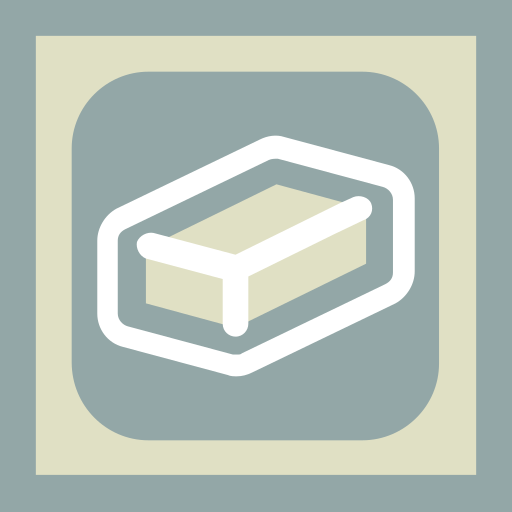
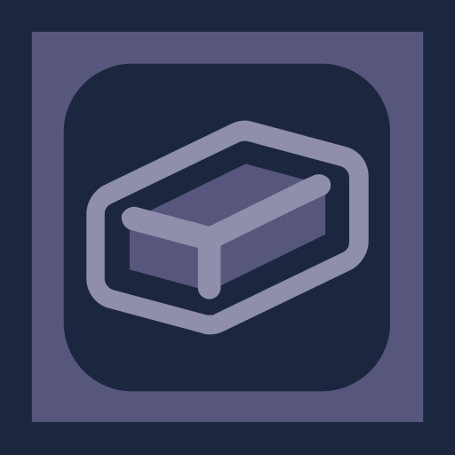
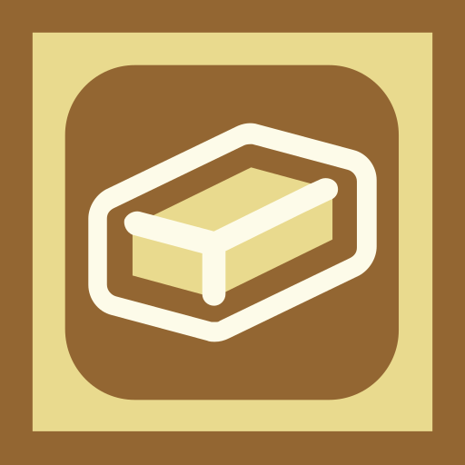
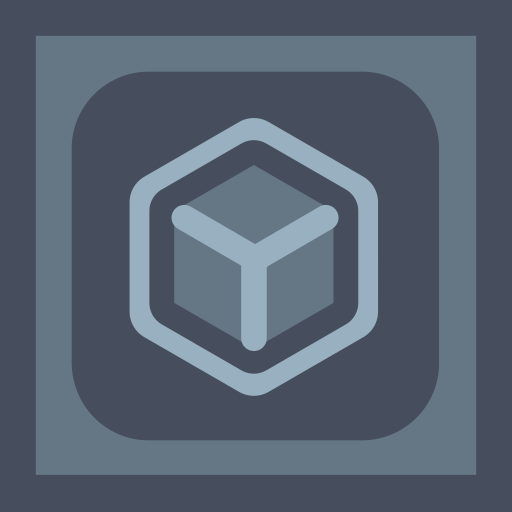
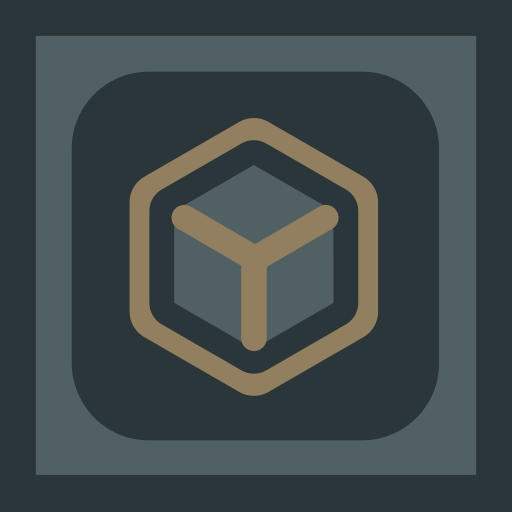

[SEPERATOR]: https://imgur.com/HAtKIrt.png
[TEAM]: https://imgur.com/ORn78Ks.png
[BLUEPRINT]: https://modrinth.com/mod/blueprint
[REPOSITORY]: https://github.com/TeamGalena/Oreganised
[YOUTUBE]: [https://github.com/TeamGalena/Oreganised](https://www.youtube.com/@TeamGalena)
[BLUESKY]: https://bsky.app/profile/teamgalena.bsky.social
[DISCORD]: https://discord.gg/JmMf7CEKsx
[PONDER]: https://github.com/Creators-of-Create/Ponder

[][BLUEPRINT]
[][YOUTUBE]
[][REPOSITORY]
[][BLUESKY]
[][DISCORD]

## 📖 About:

Oreganized is a mod inspired by the 1.17 inclusion of Copper in Minecraft and imagines how would 2 new metals look like
if they were added today. Additionally, it adds some blocks & items surrounding those metals, like the new stone type
glance or the grimstone block set.

This mod ships with [Ponder][PONDER], a form of in-game documentation. You can press `[W]` while hovering some items &
blocks to view information on how to use them.

### Silver

Can be made into:

- the mirror, which glows when undead are near.
- the scribe, which specialized in mining glass & crystal based blocks and can change the pattern of crystal glass
- the gargoyle, which can scare aware the undead by feeding it silver
- the new alloy [electrum](#electrum) by combining it with gold
- grimstone blocks & spyres
- many more decorative blocks

### Lead

Can be made into:

- molten lead, a new fluid block with unusual physics
- crystal glass, a new decorative type of dyed glass
- lead bolts, a new projectile type for the crossbow

### Electrum

A new metal alloy made from [silver](#silver) and gold. Can be used to upgrade tools & armor as an alternative to
netherite. The armor grants increased movement speed, while the tools deal additional damage based on their users
velocity.

### Glance

A new stone type that generates in boulders found on the surface. Contain some lead ore and can also be used as a source
of renewable lead.

### Grimstone

New blockset made by transforming dripstones into grimstone spyres using silver. Comes in a dark and pale variant and
goes well for gothic builds.

![][SEPERATOR]

## 📺 Showcases:

### [Refreshment Update](https://www.youtube.com/watch?v=3ekzTarUcv4&t)

### [Goopy Update](https://www.youtube.com/watch?v=GEo_93XoAKw&t)

### [Rebound Update](https://www.youtube.com/watch?v=YoZr4gfZM3M&t)

![][SEPERATOR]

## 🎞️ Compatibility:

- [Farmer's Delight](https://modrinth.com/mod/farmers-delight): Electrum Knife
- [Shield Expansion](https://modrinth.com/mod/shield-expansion): Electrum Shield
- [Create](https://modrinth.com/mod/create): Crushed Silver, Crushed Lead, Molten Lead shenanigans

![][SEPERATOR]

## 📦 Modules

Instead of downloading the entire mod, you can also pick & choose from its modules instead.
All of them depend on the core module and some have some hard dependencies between each other,
but they are decoupled as much as possible to make it possible to use them in any combination.

![][SEPERATOR]

![][SEPERATOR]

![Galena Logo][TEAM]
